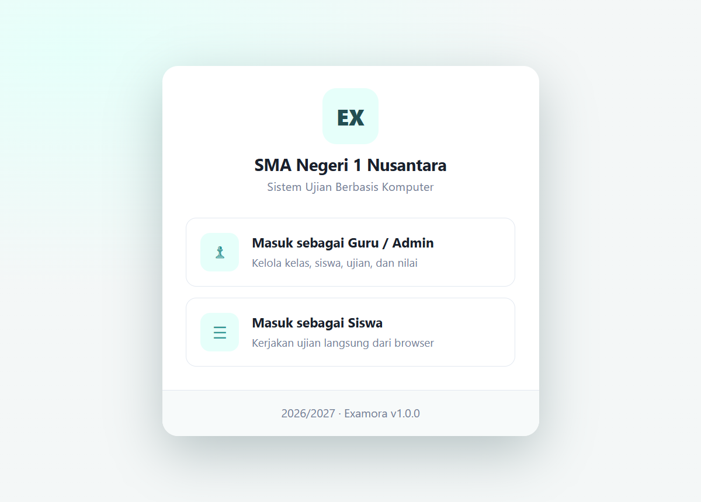
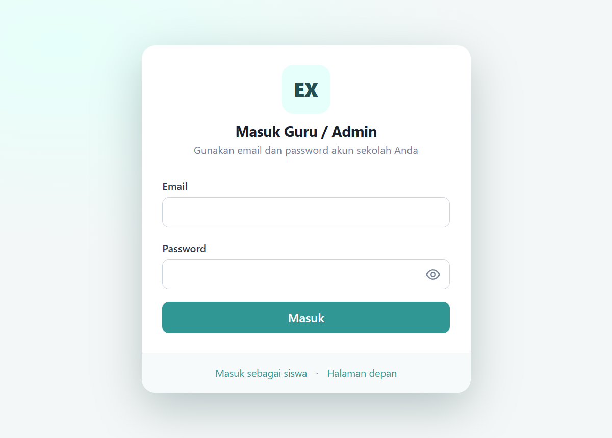
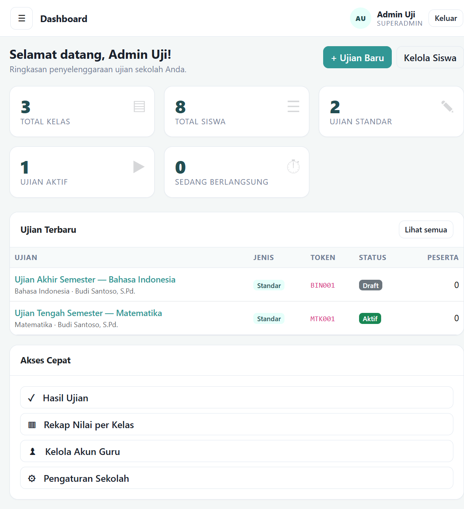
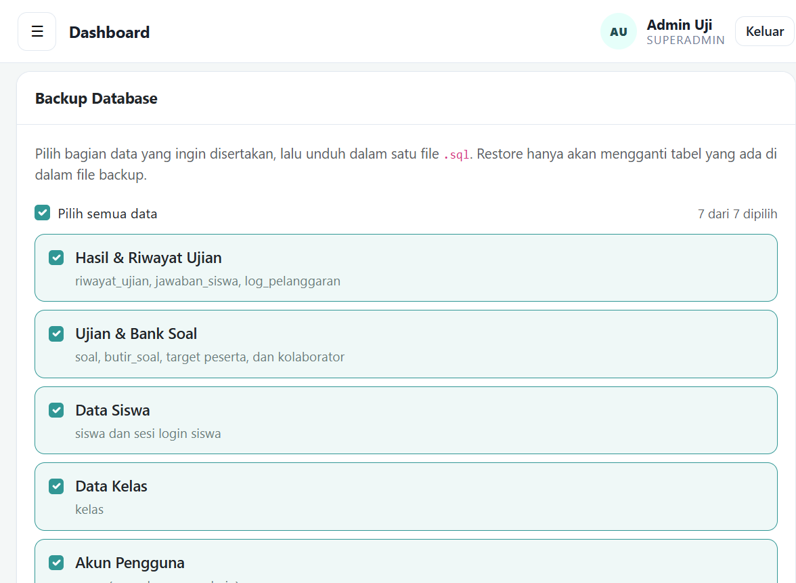

# Examora

Aplikasi **Computer Based Test (CBT)** berbasis web, gratis, dan bebas lisensi.
Ditulis dengan **PHP 8.3 native + MySQL**, tanpa framework, tanpa Composer, dan
tanpa aplikasi tambahan di sisi siswa. Siswa cukup membuka tautan ujian di browser.

## Fitur

- Login terpisah untuk **guru/admin** dan **siswa**.
- Manajemen akun guru, kelas, dan siswa (termasuk impor CSV dan cetak kartu ujian).
- Dua jenis ujian: **Standar** (PG + esai) dan **Kompleks** (6 tipe soal):
  PG, PG kompleks, benar/salah, menjodohkan, isian singkat, dan uraian
  (ujian baru selalu Standar).
- Soal **khusus PDF Google Drive**: seluruh pertanyaan dibaca siswa dari dokumen
  PDF (Google Drive) di panel kiri, sementara jawaban diisi pada lembar jawaban
  di aplikasi. Tidak ada mode ketik langsung maupun campuran.
  Form ujian hanya meminta **ID file Google Drive** (bagian `/d/<ID>/` pada
  tautan), bukan tautan penuh. Berkas PDF diunduh server lalu disajikan oleh
  aplikasi sendiri (`index.php?r=pdf_soal&id=…`), sehingga tidak bergantung
  pada cookie pihak ketiga Google Drive dan siswa hanya melihat dokumen PDF
  tanpa halaman Drive. Syaratnya berkas Drive dibagikan
  **"Siapa saja yang memiliki link" (Viewer)**; bila belum, halaman ujian
  menampilkan pesan yang jelas, bukan halaman kosong. Tautan lengkap tetap
  diterima di kolom ID — ID dan `resourcekey` diambil otomatis.
- Token ujian 6 karakter, jadwal mulai/selesai, durasi, serta durasi minimal
  pengerjaan sebelum tombol kumpulkan aktif (mencegah siswa mengumpulkan terlalu cepat).
- Target peserta fleksibel: **per jenjang**, **per kelas**, atau **siswa tertentu**,
  dengan filter tambahan per agama (mis. ujian PAI hanya untuk siswa beragama
  tertentu). Perkiraan jumlah peserta ditampilkan saat memilih target.
- Penilaian otomatis untuk soal objektif, koreksi esai per siswa atau massal.
- Rekap nilai per ujian dan per kelas, analisis butir soal, ekspor XLSX.
- Autosave jawaban, timer server, deteksi pindah tab/aplikasi, dan penguncian ujian.
- **Pengawasan ujian terpusat**: Deteksi Pindah Tab, Maks. Pelanggaran, dan Aksi
  Saat Batas Tercapai diatur admin di **Pengaturan → Pengawasan Ujian (Anti-Curang)**
  dan berlaku untuk semua ujian (guru tidak lagi mengaturnya per ujian).
- **Kunci layar anti-curang di sisi server**: saat batas pelanggaran tercapai, sesi
  siswa terkunci dan tidak bisa dilanjutkan hanya dengan memuat ulang halaman.
  Guru/superadmin membuka kunci dari **Rekap Nilai → Buka Kunci**, lalu siswa
  memuat ulang halaman untuk melanjutkan.
- **Batas login siswa**: admin menentukan berapa perangkat yang boleh login
  bersamaan (**Pengaturan → Batas Login Siswa**, default 1). Jika batas tercapai,
  login baru ditolak sampai siswa logout dari perangkat lain atau sesinya direset.
- Menu **Reset Login Siswa**: daftar perangkat yang sedang login (browser, IP,
  waktu), dengan tombol mengeluarkan satu sesi, satu siswa, atau semua sesi.
- **Pembatasan browser siswa** (opsional): admin menulis daftar browser yang
  diizinkan pada **Pengaturan → Pembatasan Browser Siswa**, dipisahkan koma,
  misalnya `chrome, SEB` (Safe Exam Browser). Jika kosong, semua browser boleh;
  jika diisi, login siswa dari browser lain ditolak dan sesi diikat ke browser
  yang dipakai saat login.
- **Wajib fullscreen saat mengerjakan ujian**: halaman ujian otomatis meminta
  mode fullscreen. Keluar dari fullscreen menampilkan overlay dengan tombol
  **Kembali ke Fullscreen** dan dicatat sebagai pelanggaran.
- Menu **Database** (superadmin): hapus data terpilih, unduh backup `.sql`,
  dan restore dari file backup.
- Audit log aktivitas penting.
- Tanpa kode registrasi, tanpa masa berlaku, tanpa pembayaran, tanpa panggilan keluar.

## Tampilan

**Pemilihan peran di halaman depan**



**Login guru / admin**



**Dashboard superadmin**



**Backup selektif di menu Database**



> Screenshot diambil dari instalasi uji dengan data contoh (SMA Negeri 1 Nusantara).

## Kebutuhan

- PHP **8.2+** (disarankan 8.3) dengan ekstensi: `pdo_mysql`, `openssl`,
  `mbstring`, `json`, `session`.
- Ekstensi tambahan: `curl` untuk soal PDF Google Drive, `gd` untuk mengubah
  ukuran logo sekolah (fitur terkait saja yang nonaktif bila tidak ada).
- MySQL **5.7+** atau MariaDB **10.4+**.
- Web server Apache/Nginx atau `php -S` untuk pengembangan.
- Tidak membutuhkan ekstensi `zip` (ekspor XLSX memakai penulis ZIP bawaan).

Panduan lengkap per jenis server (cPanel, VPS Apache, VPS Nginx, izin folder,
HTTPS, dan troubleshooting) ada di **[docs/DEPLOY.md](docs/DEPLOY.md)**.

## Instalasi

1. Unduh repo (`git clone` atau ZIP) dan letakkan folder aplikasi di web root,
   misalnya `htdocs/cbt-bebas` atau `public_html/examora`.
2. Pastikan folder `config/`, `storage/`, dan `assets/uploads/` dapat ditulis
   oleh user web server.
3. Buka `http://localhost/cbt-bebas/index.php` di browser. Halaman instalasi
   menampilkan daftar persyaratan server (versi PHP, ekstensi, dan izin folder)
   sebelum form aktif.
4. Ikuti wizard instalasi:
   - koneksi database (database dibuat otomatis bila belum ada; bila akun
     hosting tidak berhak membuat database, buat dulu lewat panel hosting),
   - identitas sekolah,
   - akun superadmin pertama.
5. Setelah selesai, aplikasi membuat `config/config.php` dan `install.lock`.
6. Masuk melalui menu **Guru / Admin** menggunakan akun superadmin tadi.

> **Pengguna Nginx:** `.htaccess` tidak dibaca Nginx. Wajib memakai aturan
> proteksi folder dari [docs/nginx-example.conf](docs/nginx-example.conf),
> jika tidak `storage/`, `database/`, dan `config/` berisiko diakses langsung.
> Lihat juga [docs/DEPLOY.md](docs/DEPLOY.md) untuk langkah lengkap.

### Menjalankan dengan PHP built-in server

```bash
php -S 127.0.0.1:8080 -t cbt-bebas
```

Lalu buka `http://127.0.0.1:8080/index.php`.

### Instalasi manual (opsional)

1. Salin `config/config.example.php` menjadi `config/config.php` dan sesuaikan.
2. Buat database, lalu impor `database/schema.sql`.
3. Buat akun superadmin:

```php
<?php
$hash = password_hash('PasswordAnda', PASSWORD_DEFAULT);
// INSERT INTO users (nama,email,password_hash,role) VALUES ('Admin','admin@sekolah.id',?, 'superadmin');
```

4. Buat file `install.lock` agar wizard tidak muncul lagi.
5. Isi tabel `pengaturan` minimal: `nama_sekolah`, `tahun_ajaran`, `kkm`.
   Key `jenjang` bersifat opsional (default `SMA`).

## Jenjang & Tingkat Kelas

Pilihan **tingkat** pada menu Data Kelas mengikuti pengaturan **Jenjang
Pendidikan** di menu Pengaturan Sekolah (SD: I–VI, SMP: VII–IX, serta
SMA/SMK/MA/Paket Umum: X–XII), sehingga aplikasi tidak terikat jenjang tertentu.
Mengganti jenjang tidak menghapus data kelas lama; nilai tingkat yang sudah
tersimpan tetap ditampilkan dan tetap dapat dipertahankan.

Pada instalasi lama, kolom `kelas.tingkat` otomatis dikonversi dari `ENUM`
menjadi `VARCHAR` saat halaman pertama dibuka (migrasi ringan di
`app/bootstrap.php`) — tidak perlu menjalankan SQL secara manual.

## Alur Penggunaan

1. **Admin** membuat kelas dan akun guru. Menu **Data Kelas** dan **Data Siswa**
   hanya tersedia untuk superadmin — guru tidak bisa mengubah data induk.
   Menu **Reset Login Siswa** tetap bisa dibuka guru untuk mengeluarkan siswa
   dari perangkat yang salah atau lupa logout.
2. **Guru** membuat ujian, memilih target peserta (per tingkat, per kelas, atau
   siswa spesifik, plus filter agama), lalu mengisi kunci jawaban.
3. **Pemilik ujian** dapat menambah **kolaborator** (akun guru lain) lewat
   tombol **Kolaborator** di menu Data Soal. Kolaborator memiliki akses penuh
   yang sama: mengubah ujian, mengisi kunci, mengoreksi, dan melihat hasil.
   Hanya pemilik (atau superadmin) yang bisa menambah/mengeluarkan kolaborator.
4. Aktifkan ujian dan bagikan **token** kepada siswa.
5. **Siswa** masuk memakai username/password dari kartu ujian, memilih ujian,
   memasukkan token, dan mulai mengerjakan.
6. Jawaban objektif dinilai otomatis. Esai dikoreksi guru melalui menu
   **Koreksi Esai**.
7. Guru mengekspor nilai ke Excel atau mencetak kartu peserta.

## Database, Backup & Restore

Menu **Sistem → Database** hanya tersedia untuk superadmin.

- **Hapus data selektif** — pilih jenis data (riwayat, ujian, siswa, kelas, akun
  guru, audit log, atau log pelanggaran), lalu ketik `HAPUS`. Penghapusan mengikuti
  relasi data, misalnya menghapus kelas juga menghapus siswa di dalamnya.
- **Backup** — memilih bagian data yang ingin disertakan (riwayat, bank soal,
  siswa, kelas, akun, audit log, pengaturan), lalu mengunduhnya dalam satu file
  `.sql`. Secara bawaan semua bagian tercentang sehingga isinya sama dengan
  backup penuh. Simpan file ini di tempat aman; file berisi akun, password hash,
  dan data siswa.
- **Restore** — mengganti seluruh data saat ini dengan isi file backup. Selalu
  unduh backup terbaru sebelum melakukan restore.

Keduanya hanya menerima file backup yang dibuat oleh Examora. Proses restore
mematikan pemeriksaan foreign key sementara dan mencatat hasilnya ke audit log.

## Struktur Folder

```
examora/
├── index.php              # front controller (routing ?r=...)
├── .htaccess              # proteksi folder internal
├── app/                   # bootstrap, inti, controller, penilaian, xlsx
├── assets/                # CSS, JS, Bootstrap lokal, upload logo
├── config/                # config.php (dibuat installer)
├── database/schema.sql    # skema database
├── docs/                  # panduan deploy & contoh konfigurasi Nginx
├── storage/               # log, cache, file sesi (harus dapat ditulis)
└── views/                 # template PHP
```

## Keamanan

- Password staf dan siswa disimpan dengan `password_hash()`.
- Password pada kartu ujian disimpan terenkripsi AES-256-GCM memakai `app_key`.
- Semua form POST memakai token CSRF.
- Query database memakai prepared statement PDO.
- Folder `app/`, `config/`, `database/`, `storage/`, dan `views/` diblokir
  dari akses langsung melalui `.htaccess` (Apache) maupun aturan `deny` pada
  contoh konfigurasi Nginx di `docs/nginx-example.conf`.
- Login dibatasi percobaan berulang (rate limit berbasis file).
- File sesi PHP disimpan di `storage/sessions` (bukan folder sesi bersama
  hosting) agar tidak ikut dibersihkan aplikasi lain. Cookie login siswa
  berlaku hingga 12 jam supaya browser HP yang ditutup sistem tidak membuat
  siswa keluar; sesi tetap dibatasi di server oleh aturan idle 2 jam, logout,
  atau reset oleh admin/guru. Cookie staf tetap berakhir saat browser ditutup.

> **Penting:** jangan bagikan `config/config.php` dan `install.lock`.
> Cadangkan database secara berkala.

## Lisensi

Dirilis dengan lisensi **MIT** — lihat [LICENSE](LICENSE). Anda bebas memakai,
mengubah, dan mendistribusikan aplikasi ini, termasuk untuk kebutuhan komersial,
dengan tetap mencantumkan hak cipta dan teks lisensi. Tidak ada biaya lisensi,
registrasi, atau masa kedaluwarsa.
